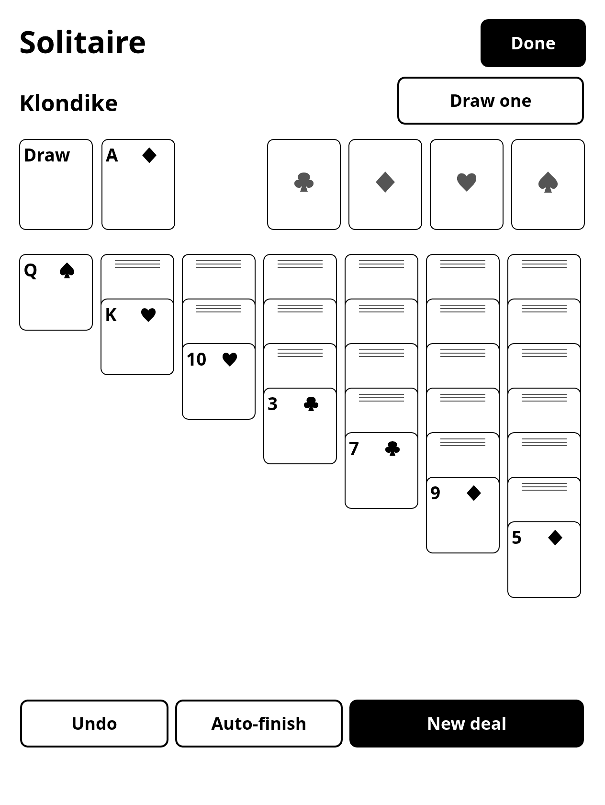
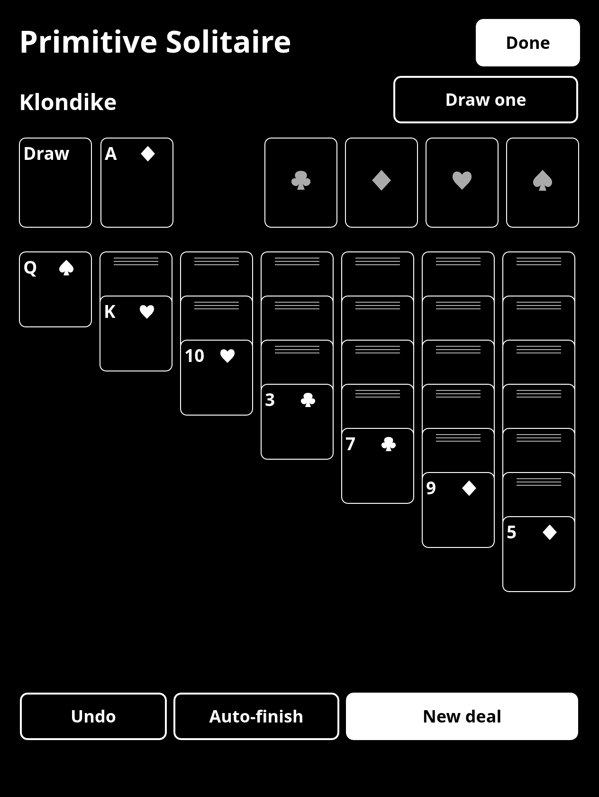

<div align="center">

# Solitaire

**Play Klondike on Kindle**

[](https://github.com/PrimitiveOS/kindle-primitive-solitaire/actions/workflows/ci.yml)
[](https://github.com/PrimitiveOS/kindle-primitive-solitaire/releases)
[](https://github.com/PrimitiveOS/kindle-primitive-solitaire/tags)
[](LICENSE)
[](https://github.com/PrimitiveOS/kindle-primitive-solitaire/stargazers)
[](https://primitiveos.github.io/kindle-primitive-catalog/v1/index.json)

[**Download**](https://github.com/PrimitiveOS/kindle-primitive-solitaire/releases/latest) · [**Install guide**](INSTALL.md) · [**Changelog**](CHANGELOG.md)

</div>

---

Play draw-one or draw-three Klondike with tap controls and undo.

## Quick start

After setting up PrimitiveOS, open **Store** from Primitive Launcher. Choose **Solitaire** under **Apps**,
tap **Get**, and open it from the Launcher grid. The [install guide](INSTALL.md) also covers the standalone USB package.

## Screenshots

<table>
  <tr>
    <td align="center"><br><sub>Draw-one Klondike</sub></td>
    <td align="center"><br><sub>The deal in dark mode</sub></td>
  </tr>
</table>

<sub>Screenshots from the desktop simulator at 1264 × 1680, using a sample deal.</sub>

## Highlights

- **Draw one or three.** Choose how many cards to turn over from the stock.
- **Undo and resume.** Reopen your saved deal with its recent undo history.
- **Auto-finish.** Send the remaining cards to their suit piles once they can all be moved there.

## Develop locally

Keep the Primitive Tools and Launcher repositories beside this checkout. The desktop command plays a sample
draw and writes PNG previews to `build/previews`.

```sh
cargo test --offline --locked --workspace
cargo run --offline --locked -p solitaire-desktop
```

## Status

| Device | Status |
|---|---|
| Kindle Oasis 3 (1264 × 1680, firmware 5.18.2) | Tested on hardware |

**Current version: 0.1.1.** Changes are in [CHANGELOG.md](CHANGELOG.md).

## Downloads

The badge at the top shows the number of Store downloads. It counts GitHub downloads of this app's release packages, across all versions and architectures, and is refreshed daily from the [Store catalog](https://primitiveos.github.io/kindle-primitive-catalog/v1/index.json).

## Documentation

[Install guide](INSTALL.md) · [Changelog](CHANGELOG.md) · [Device notes](docs/device-notes.md)

## Licence

Copyright (C) 2026 Doan Nguyen.

- Original code is under the [PolyForm Noncommercial License 1.0.0](LICENSE).
- Original documentation and pictures, including these screenshots, are under [CC BY-NC-SA 4.0](LICENSE-DOCS).
- The Noto Sans fonts supplied by Primitive Launcher retain their SIL Open Font License.
